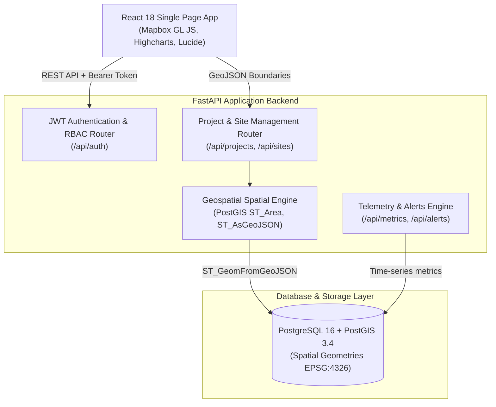
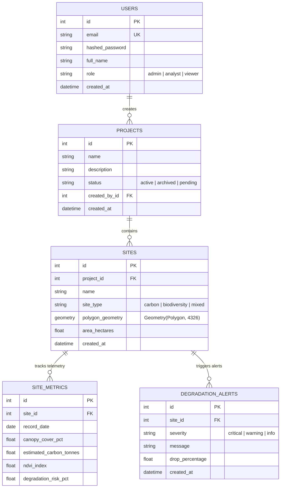

# Darukaa.Earth — Carbon & Biodiversity Ops Console

> **Full-Stack Geospatial Analytics Platform for Carbon Credit & Biodiversity Project Operations**  
> Designed & Built for the **Darukaa.Earth Full-Stack Developer Hackathon Challenge**.

---

## 🌟 Executive Overview

**Darukaa.Earth** is an enterprise-grade, high-density geospatial analytics and management console for carbon offset and biodiversity conservation projects. Built with **React 18**, **Mapbox GL JS v3**, **Highcharts**, **FastAPI**, and **PostgreSQL with PostGIS extensions**, it enables asset managers, field analysts, and auditors to map land boundaries, track real-time canopy density, monitor telemetry metrics over time, and detect vegetation degradation.

---

## 🏗️ System Architecture



### Technology Stack
- **Frontend Framework**: React 18, TypeScript, Vite, Vanilla CSS with CSS Custom Properties (Stitch Design System).
- **Mapping & GIS Engine**: Mapbox GL JS v3 (Satellite Streets, Vector Light & Outdoors tilesets), `@mapbox/mapbox-gl-draw`.
- **Data Visualization**: Highcharts & Highcharts React (Telemetry & canopy density timeline charts).
- **Backend API**: Python 3.11, FastAPI, SQLAlchemy 2.0 (Async ORM), GeoAlchemy2, Pydantic v2.
- **Database**: PostgreSQL 16 with PostGIS 3.4 spatial extensions (`geometry(Polygon, 4326)`).
- **Authentication**: OAuth2 Password Flow with JWT Bearer Tokens & Role-Based Access Control (Admin, Analyst, Viewer).
- **CI/CD & DevEx**: GitHub Actions, Husky pre-commit hooks, `lint-staged`, ESLint, Prettier, Black, Ruff.

---

## 🗄️ Database Schema & Models



---

## ⚡ Quick Start & Local Setup

### Option 1: One-Command Setup with Docker Compose (Recommended)

Make sure Docker and Docker Compose are installed:

```bash
# Clone the repository
git clone https://github.com/Vignesss16/Darukaa.Earth.git
cd Darukaa.Earth

# Start PostgreSQL/PostGIS database, FastAPI backend, and React frontend
docker-compose up --build
```

The application will be accessible at:
- **Frontend Dashboard**: `http://localhost:5173`
- **FastAPI OpenAPI Documentation**: `http://localhost:8000/docs`

---

### Option 2: Manual Development Setup

#### 1. Backend Setup (FastAPI + PostgreSQL PostGIS)

```bash
cd backend

# Create and activate Python virtual environment
python -m venv venv
# On Windows:
venv\Scripts\activate
# On Linux/macOS:
source venv/bin/activate

# Install backend dependencies
pip install -r requirements.txt

# Create .env configuration file
cp .env.example .env

# Run database migrations / initialization & start dev server
python -m app.main
# Or run with uvicorn:
uvicorn app.main:app --reload --port 8000
```

#### 2. Frontend Setup (React 18 + Vite)

```bash
cd frontend

# Install dependencies
npm install

# Create environment file with Mapbox token (optional fallback provided)
echo "VITE_MAPBOX_TOKEN=pk.your_mapbox_public_token_here" > .env

# Start Vite development server
npm run dev
```

---

## 🔑 Pre-seeded Demo Credentials

The backend automatically seeds demo accounts on initial startup:

| Role | Email | Password | Access Rights |
| :--- | :--- | :--- | :--- |
| **Administrator** | `admin@darukaa.earth` | `Admin123!` | Create/delete projects & sites, draw boundaries, seed telemetry data |
| **Analyst** | `analyst@darukaa.earth` | `Analyst123!` | Draw sites, view analytics, inspect alerts, export PDF reports |
| **Viewer** | `viewer@darukaa.earth` | `Viewer123!` | Read-only inspection of projects, sites, and telemetry charts |

---

## 🚀 CI/CD Pipeline & Code Quality Controls

### Automated GitHub Actions Workflow (`.github/workflows/ci.yml`)

The repository includes an automated CI/CD pipeline triggered on every `push` and `pull_request` to `main`:
1. **Frontend Pipeline**: Runs TypeScript check (`tsc`), ESLint checks, and builds production bundles (`vite build`).
2. **Backend Pipeline**: Installs Python dependencies, executes `ruff` & `black` code quality checks, and executes `pytest` suite.

### Local Pre-Commit Hooks (Husky + lint-staged)

To ensure code stability and maintain strict style compliance before every commit:
- **Husky** intercepts `git commit`.
- **lint-staged** automatically runs `prettier --write` and `eslint --fix` on modified React components, and `black` / `ruff` on Python scripts.

---

## 🤝 Reviewer Repository Access

Access invitations have been granted to the Darukaa hiring team GitHub accounts:
- `ankita.dasgupta@darukaa.com`
- `harsh.kumar@darukaa.com`
- `utkarsh.gauniyal@darukaa.com`
- `guneet.mutreja@darukaa.com`
