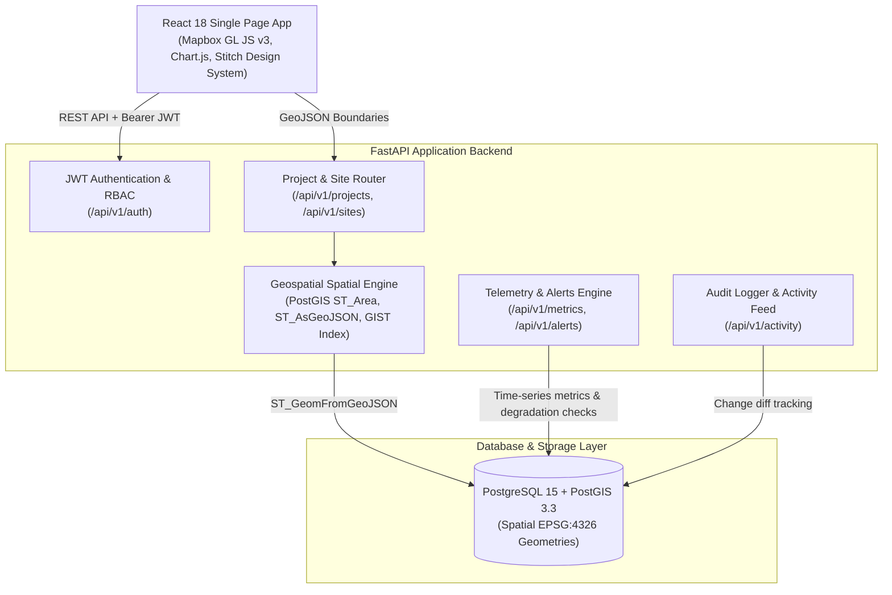
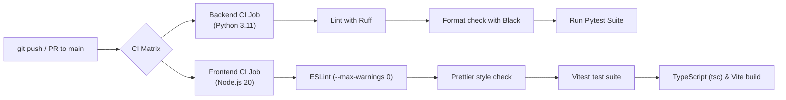

# Darukaa.Earth — Carbon & Biodiversity Ops Console

> **Enterprise-Grade Planetary Intelligence & Geospatial Analytics Console for Carbon Credit Verification & Biodiversity Conservation**  
> Built for the **Darukaa.Earth Full-Stack Developer Assessment**.

[](https://github.com/Vignesss16/Darukaa.Earth/actions/workflows/ci.yml)
[](https://fastapi.tiangolo.com)
[](https://reactjs.org)
[](https://postgis.net)
[](https://www.typescriptlang.org/)

---

## 🌐 Live Cloud Deployment

| Service | Live Deployment URL | Description |
| :--- | :--- | :--- |
| **Production Web Console** | [https://darukaa-earth-vjbu.onrender.com/](https://darukaa-earth-vjbu.onrender.com/) | React 18 + Mapbox GL JS Single Page App |
| **FastAPI REST API & Docs** | [https://darukaa-backend-fbo2.onrender.com/docs](https://darukaa-backend-fbo2.onrender.com/docs) | Interactive Swagger / OpenAPI 3.0 Explorer |
| **API Health & DB Check** | [https://darukaa-backend-fbo2.onrender.com/health](https://darukaa-backend-fbo2.onrender.com/health) | Live Service & PostGIS Database Liveness Endpoint |

---

## 🌟 Executive Overview

**Darukaa.Earth** is an enterprise-grade geospatial analytics and operations console designed for carbon offset verifiers, biodiversity conservation managers, and environmental auditors. Built with **React 18**, **Mapbox GL JS v3**, **Chart.js**, **FastAPI**, and **PostgreSQL 15 with PostGIS 3.3 spatial extensions**, the platform empowers operators to:
- Map, edit, and inspect land parcels with sub-meter spatial accuracy and automatic geodesic area calculation.
- Track multidimensional telemetry metrics (NDVI, Canopy Density, Carbon Stock, Deforestation Area, Fire Incidents).
- Detect vegetation degradation anomalies through automated consecutive reading change triggers (>10% drop).
- Ingest historical sensor and Kaggle INPE datasets via an intelligent dynamic CSV mapping pipeline.
- Engage **Darukaa Planetary AI**, an interactive copilot that renders inline telemetry charts, 4-stat analysis grids, and triggers executive PDF dossier exports directly within the chat interface.
- Export executive 1-page compliance PDF reports and multi-site telemetry comparisons.

---

## 🤖 Darukaa Planetary AI — Scoped Environmental Copilot

**Darukaa Planetary AI** is an advanced, context-aware copilot integrated directly into the Site Detail panel (`Ask AI` tab). Rather than acting as a simple text-generating bot, it functions as an **interactive operational copilot** tightly coupled with ground-truth site telemetry, PostGIS spatial queries, and compliance workflows:

- 📊 **Inline Multi-Spectral Chart Generation**: Queries regarding trends or time-series data dynamically render **live Chart.js telemetry charts** directly inside the conversation stream.
- ⚡ **Instant 4-Stat Telemetry Analysis Grids**: Prompts requesting an analysis, audit, or deep dive render a 4-stat metric grid (**Canopy Cover %**, **Carbon Biomass Stock**, **NDVI Score**, and **Active Alert Status**).
- 🖨️ **Certified Executive PDF Dossier Export**: Prompting for a dossier or PDF report dynamically injects an **Export PDF Dossier** button, allowing operators to trigger 1-page print compliance reports instantly.
- 🧠 **Contextually Scoped Ground-Truth Intelligence**: Powered by Groq LLM orchestration and strictly scoped to the selected site's boundary polygon, acreage, vegetation telemetry, and active degradation alerts.
- 📐 **Dual Display Modes**: Seamlessly switches between a drawer slide-over panel view and a centered enlarged modal view with keyboard navigation (`Esc` shortcut).

---

## 🏗️ System Architecture



### Technology Stack
- **Frontend**: React 18, TypeScript 5.2, Vite 5, Vanilla CSS with custom design tokens (Stitch "Precision Planetary Intelligence" theme).
- **Mapping & GIS Engine**: Mapbox GL JS v3, `@mapbox/mapbox-gl-draw` (Satellite Streets, Vector Light, and Outdoors tilesets).
- **Data Visualization**: Chart.js 4.5 & `react-chartjs-2` 5.3 (Chronological multi-metric timeline charts).
- **Backend API**: Python 3.11, FastAPI, SQLAlchemy 2.0 (ORM), GeoAlchemy2, Pydantic v2.
- **Database**: PostgreSQL 15 with PostGIS 3.3 spatial extensions (`geometry(Polygon, 4326)` with GIST spatial indexing).
- **Authentication**: OAuth2 Password Flow with JWT Bearer tokens and role-based permissions (`admin`, `analyst`, `viewer`).
- **CI/CD & Code Quality**: GitHub Actions (dual backend + frontend matrix), Husky pre-commit hooks, ESLint, Prettier, Black, Ruff.

---

## 🗄️ Database Schema & Relational Models

The relational database architecture is defined in `backend/app/models.py` with SQLAlchemy ORM and PostGIS spatial extensions:

### 1. `users` Table
Stores user accounts and authentication credentials with role-based access control (RBAC).
- `id` (Integer, Primary Key, Index)
- `email` (String(255), Unique, Not Null, Index)
- `hashed_password` (String(255), Not Null) — Bcrypt salted password hash
- `full_name` (String(255), Not Null)
- `role` (`Enum('admin', 'analyst', 'viewer')`, Not Null, Default: `'viewer'`)
- `created_at` (DateTime with Timezone, Server Default: `func.now()`)
- **Relationships**: `projects` (1-to-many), `audit_logs` (1-to-many)

### 2. `projects` Table
Organizes conservation sites into top-level project containers.
- `id` (Integer, Primary Key, Index)
- `name` (String(255), Not Null)
- `description` (Text, Nullable)
- `owner_id` (Integer, Foreign Key ➔ `users.id`, Not Null)
- `status` (`Enum('active', 'archived')`, Not Null, Default: `'active'`)
- `created_at` (DateTime with Timezone, Server Default: `func.now()`)
- **Relationships**: `owner` (many-to-1 with `User`), `sites` (1-to-many with `Site`, cascade delete)

### 3. `sites` Table
Stores parcel spatial geometries and metadata.
- `id` (Integer, Primary Key, Index)
- `project_id` (Integer, Foreign Key ➔ `projects.id`, Not Null)
- `name` (String(255), Not Null)
- `geom` (`Geometry(POLYGON, srid=4326, spatial_index=True)`, Not Null) — PostGIS indexed polygon
- `area_hectares` (Numeric(12, 4), Nullable) — Geodesic area calculated via `ST_Area(geography)`
- `site_type` (`Enum('carbon', 'biodiversity', 'mixed')`, Not Null, Default: `'mixed'`)
- `created_by_id` (Integer, Foreign Key ➔ `users.id`, Nullable)
- `created_at` (DateTime with Timezone, Server Default: `func.now()`)
- **Relationships**: `project` (many-to-1), `creator` (many-to-1), `metrics` (1-to-many with `SiteMetric`, cascade delete)

### 4. `site_metrics` Table
High-frequency time-series telemetry records for individual sites.
- `id` (Integer, Primary Key, Index)
- `site_id` (Integer, Foreign Key ➔ `sites.id`, Not Null)
- `metric_type` (`Enum('ndvi', 'carbon_tons', 'biodiversity_index', 'canopy_cover', 'deforestation_area_km2', 'fire_incidents')`, Not Null)
- `value` (Numeric(12, 4), Not Null)
- `recorded_at` (Date, Not Null)
- `source` (String(100), Not Null, Default: `'manual'`)
- **Relationships**: `site` (many-to-1 with `Site`)

### 5. `audit_log` Table
Immutable audit trail capturing user actions, mutations, and JSON diffs.
- `id` (Integer, Primary Key, Index)
- `user_id` (Integer, Foreign Key ➔ `users.id`, Nullable)
- `action` (String(100), Not Null) — e.g., `CREATE_SITE`, `UPDATE_SITE`, `BULK_IMPORT_METRICS`
- `entity_type` (String(100), Not Null) — e.g., `site`, `project`, `metric`
- `entity_id` (String(100), Not Null)
- `diff` (JSON, Nullable) — Before/after mutation payload
- `created_at` (DateTime with Timezone, Server Default: `func.now()`)
- **Relationships**: `user` (many-to-1 with `User`)

---

## 🔑 Pre-seeded Demo Credentials

The backend automatically seeds demo accounts with predefined permissions on initial startup:

| Role | Email | Password | Access Rights |
| :--- | :--- | :--- | :--- |
| **Administrator** | `admin@darukaa.earth` | `admin123` | Full access: create/delete projects & sites, draw boundaries, bulk CSV import, user management |
| **Analyst** | `analyst@darukaa.earth` | `analyst123` | Draw & edit sites, view telemetry charts, inspect alerts, export executive PDF reports |
| **Viewer** | `viewer@darukaa.earth` | `viewer123` | Read-only inspection of projects, interactive map, and telemetry charts |

---

## ⚡ Quick Start & Local Setup

### Option 1: One-Command Setup with Docker Compose (Recommended)

```bash
# Clone repository
git clone https://github.com/Vignesss16/Darukaa.Earth.git
cd Darukaa.Earth

# Start PostgreSQL 15 / PostGIS 3.3, FastAPI backend, and React frontend
docker-compose up --build
```

Access the local environment:
- **Web App Console**: `http://localhost:5173`
- **FastAPI OpenAPI Documentation**: `http://localhost:8000/docs`

---

### Option 2: Manual Development Setup

#### 1. Backend Setup (FastAPI + PostgreSQL PostGIS)
```bash
cd backend
python -m venv venv
# Windows: venv\Scripts\activate | Linux/macOS: source venv/bin/activate
pip install -r requirements.txt
cp .env.example .env
python -m app.main
```

#### 2. Frontend Setup (React 18 + Vite)
```bash
cd frontend
npm install
npm run dev
```

---

## 📊 Telemetry Metrics, CSV Ingestion & INPE Brazilian Amazon Dataset

### 1. Extended Telemetry Metrics Schema
The PostgreSQL native `metrictype` enum and SQLAlchemy models support 6 telemetry metric types:
- `ndvi`: Normalized Difference Vegetation Index (0.00 to 1.00)
- `canopy_cover`: Percentage tree canopy cover (0% to 100%)
- `carbon_tons`: Estimated carbon biomass stock (metric tonnes CO₂e)
- `biodiversity_index`: Ecological species diversity index (0.00 to 1.00)
- `deforestation_area_km2`: Annual tree loss area in square kilometers
- `fire_incidents`: Thermal anomaly and wildfire count

### 2. Intelligent CSV Import Pipeline (UI)
- Accessible via the **Analytics** tab on any site.
- Dynamically parses CSV headers and enables custom column mapping (supports ISO dates, `YYYY-MM-DD`, `YYYY/MM/DD`, or bare `YYYY` years).
- Validates row records, highlights invalid rows with line numbers, displays a 5-row preview table, and bulk-inserts validated rows via `POST /api/v1/sites/{site_id}/metrics/bulk`.

### 3. Kaggle INPE Brazilian Amazon Integration
Automated ingestion script populating 9 Brazilian Legal Amazon states with official PRODES deforestation and BDQueimadas wildfire data:
```bash
# Via Docker:
docker exec -it darukaa_backend python scripts/import_kaggle_data.py

# Or locally:
cd backend && python scripts/import_kaggle_data.py
```

---

## 💡 Decisions & Architectural Trade-offs

1. **PostGIS Native Geometries vs Client-Side GeoJSON**:
   - *Decision*: Stored spatial boundaries as PostGIS `GEOMETRY(Polygon, 4326)` with GIST spatial indexing.
   - *Rationale*: Guarantees geodesic calculations (`ST_Area(geography)`) are computed directly by the database engine with zero projection distortion, eliminating discrepancies between client coordinates and verified surface area.

2. **Real Kaggle INPE Data vs Documented NDVI Seasonal Mock**:
   - *Decision*: Deforestation area (`deforestation_area_km2`) and wildfire incidents (`fire_incidents`) use real historical records from Brazil's National Institute for Space Research (INPE PRODES & BDQueimadas datasets 1999–2019). Meanwhile, NDVI and canopy cover are simulated via a seasonal sine-wave model (`backend/app/services/metrics.py`), with `fetch_sentinel2_ndvi_live()` explicitly documented as an architectural placeholder for future Copernicus/GEE API integration.
   - *Rationale*: Full satellite pipeline integration requires paid API keys and live raster tiles. Using real historical INPE data for deforestation/fires grounds the metrics in real planetary telemetry while providing an honest, documented mock for live satellite streaming.

3. **Native PostgreSQL Enum vs Generic Strings for Metrics**:
   - *Decision*: Implemented `metric_type` as a native database ENUM `metrictype` with strict Pydantic validation.
   - *Rationale*: Reduces indexed column footprint to 4 bytes per row for high-frequency time-series data while providing validation at the database constraint layer.

4. **Chart.js vs Heavy Visualization Frameworks**:
   - *Decision*: Selected Chart.js 4.5 with canvas rendering.
   - *Rationale*: Ensures smooth, lightweight canvas-based rendering without DOM overhead, and scales comfortably if telemetry density increases in the future.

5. **Client-Side Print CSS for Executive PDF Reports**:
   - *Decision*: Implemented dedicated `@media print` stylesheets and DOM isolation.
   - *Rationale*: Eliminates the need for heavy server-side headless browser dependencies (like Puppeteer or Playwright), reducing container image size and cloud memory overhead.

---

## 🚀 CI/CD Pipeline & Code Quality Controls

The repository incorporates an automated GitHub Actions workflow defined in [`.github/workflows/ci.yml`](.github/workflows/ci.yml) that executes on every `push` and `pull_request` to `main`:



- **Backend Job (`backend-ci`)**:
  - Python 3.11 environment setup with cached pip dependencies.
  - `ruff check .` for static analysis and bug prevention.
  - `black --check .` for strict code formatting compliance.
  - `pytest` running full unit test suites for auth, RBAC, sites, telemetry, Kaggle import, and alerts.
- **Frontend Job (`frontend-ci`)**:
  - Node.js environment setup with cached npm dependencies.
  - `npm run lint`: ESLint with `--max-warnings 0` for zero-warning policy.
  - `npm run format:check`: Prettier check across all `.ts`, `.tsx`, and `.css` files.
  - `npm run test`: Vitest unit tests verifying token storage and core modules.
  - `npm run build`: Strict TypeScript typecheck (`tsc`) followed by production Vite bundling.

---

## 🚧 Known Limitations & Next Steps

- **Render Free-Tier Database Lifecycle**: The PostgreSQL database on Render free-tier expires 30 days after provisioning and will require recreation/reseeding if evaluated past that window.
- **MultiPolygon Draw Tooling**: The map drawing engine captures single closed Polygons. Complex multi-parcel conservation zones can be uploaded via GeoJSON but cannot currently be multi-edited in a single drawing session.
- **Direct Earth Engine API Connectors**: Telemetry currently ingests via CSV and automated datasets. Integration with Copernicus Sentinel Hub / Google Earth Engine REST API is planned for live satellite raster ingestion.
- **WebSocket Streaming**: Telemetry alert feeds currently leverage polling; native WebSockets are planned for multi-analyst real-time collaborative map annotations.
