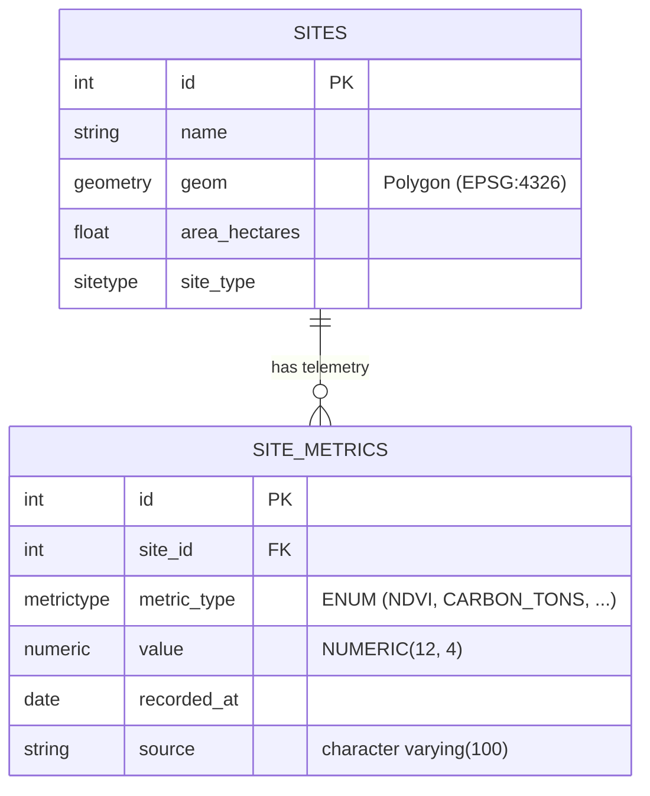

# Technical Specification: `site_metrics` Schema & Architecture

This document provides a comprehensive reference for the `site_metrics` schema in **Darukaa.Earth**, detailing its SQLAlchemy ORM implementation, native PostgreSQL database mapping, Alembic migrations, Pydantic validation, and data lifecycle.

---

## 1. Architectural Summary

| Attribute | Specification |
| :--- | :--- |
| **Table Name** | `site_metrics` |
| **ORM Framework** | SQLAlchemy 2.x Declarative Base |
| **Database Engine** | PostgreSQL 15 + PostGIS 3.3 |
| **`metric_type` Representation** | **Native PostgreSQL `ENUM`** (`metrictype`), mapped via Python `enum.Enum` |
| **Foreign Key Relationship** | `site_id` $\rightarrow$ `sites.id` (`ON DELETE CASCADE` configured via SQLAlchemy relationship) |
| **Temporal Granularity** | `recorded_at` (`DATE`), indexing multi-spectral and sensor survey passes |
| **Precision** | `NUMERIC(12, 4)` for sub-meter NDVI, tons of carbon biomass, and canopy percentages |



---

## 2. SQLAlchemy Model Definition

Source location: `backend/app/models.py`

### 2.1 Python Enum Class
```python
import enum

class MetricType(str, enum.Enum):
    NDVI = "ndvi"
    CARBON_TONS = "carbon_tons"
    BIODIVERSITY_INDEX = "biodiversity_index"
    CANOPY_COVER = "canopy_cover"
```

### 2.2 Model Declaration
```python
from sqlalchemy import Column, Date, Enum, ForeignKey, Integer, Numeric, String
from sqlalchemy.orm import relationship
from app.database import Base

class SiteMetric(Base):
    __tablename__ = "site_metrics"

    id = Column(Integer, primary_key=True, index=True)
    site_id = Column(Integer, ForeignKey("sites.id"), nullable=False)
    metric_type = Column(Enum(MetricType), nullable=False)
    value = Column(Numeric(12, 4), nullable=False)
    recorded_at = Column(Date, nullable=False)
    source = Column(String(100), nullable=False, default="manual")

    site = relationship("Site", back_populates="metrics")
```

### 2.3 Column-by-Column Breakdown

| Column | Python / ORM Type | SQL Type | Nullable | Default | Description |
| :--- | :--- | :--- | :---: | :--- | :--- |
| `id` | `Integer` | `INTEGER` | No | Auto-sequence | Primary key. |
| `site_id` | `Integer` | `INTEGER` | No | None | Foreign key pointing to `sites.id`. |
| `metric_type` | `Enum(MetricType)` | `metrictype` (native ENUM) | No | None | Standardized telemetry parameter. |
| `value` | `Numeric(12, 4)` | `NUMERIC(12, 4)` | No | None | Observation value with 4-decimal precision. |
| `recorded_at` | `Date` | `DATE` | No | None | Date of survey, satellite flyover, or calculation. |
| `source` | `String(100)` | `VARCHAR(100)` | No | `"manual"` | Origin identifier (e.g. `"sentinel-2"`, `"gedi"`, `"drone"`). |

---

## 3. Database Layer: Native PostgreSQL Type

Unlike SQLite or databases without custom types, PostgreSQL stores `metric_type` as a **custom native enum type** called `metrictype`.

### 3.1 Live PostgreSQL DDL (`\d site_metrics`)
```sql
Table "public.site_metrics"
   Column    |          Type          | Collation | Nullable |                 Default                  
-------------+------------------------+-----------+----------+------------------------------------------
 id          | integer                |           | not null | nextval('site_metrics_id_seq'::regclass)
 site_id     | integer                |           | not null | 
 metric_type | metrictype             |           | not null | 
 value       | numeric(12,4)          |           | not null | 
 recorded_at | date                   |           | not null | 
 source      | character varying(100) |           | not null | 
Indexes:
    "site_metrics_pkey" PRIMARY KEY, btree (id)
    "ix_site_metrics_id" btree (id)
Foreign-key constraints:
    "site_metrics_site_id_fkey" FOREIGN KEY (site_id) REFERENCES sites(id)
```

### 3.2 Native ENUM Metadata (`\dT+ metrictype`)
```sql
                                              List of data types
 Schema |    Name    | Internal name | Size |      Elements      |  Owner   | Description 
--------+------------+---------------+------+--------------------+----------+-------------
 public | metrictype | metrictype    | 4    | NDVI              +| postgres | Telemetry type
        |            |               |      | CARBON_TONS       +|          | 
        |            |               |      | BIODIVERSITY_INDEX+|          | 
        |            |               |      | CANOPY_COVER       |          | 
```

> **Note**: PostgreSQL stores native enums as 4-byte identifiers internally, offering lower storage footprints and faster indexing than `VARCHAR` columns.

---

## 4. Alembic Migration Implementation

Source location: `backend/alembic/versions/001_initial_schema.py`

### 4.1 `upgrade()` Script
```python
def upgrade() -> None:
    # 4. site_metrics table
    op.create_table(
        "site_metrics",
        sa.Column("id", sa.Integer(), nullable=False),
        sa.Column("site_id", sa.Integer(), nullable=False),
        sa.Column(
            "metric_type",
            sa.Enum(
                "NDVI",
                "CARBON_TONS",
                "BIODIVERSITY_INDEX",
                "CANOPY_COVER",
                name="metrictype",
            ),
            nullable=False,
        ),
        sa.Column("value", sa.Numeric(precision=12, scale=4), nullable=False),
        sa.Column("recorded_at", sa.Date(), nullable=False),
        sa.Column("source", sa.String(length=100), nullable=False),
        sa.ForeignKeyConstraint(
            ["site_id"],
            ["sites.id"],
        ),
        sa.PrimaryKeyConstraint("id"),
    )
    op.create_index(op.f("ix_site_metrics_id"), "site_metrics", ["id"], unique=False)
```

### 4.2 `downgrade()` Script
```python
def downgrade() -> None:
    op.drop_index(op.f("ix_site_metrics_id"), table_name="site_metrics")
    op.drop_table("site_metrics")

    # Drop the PostgreSQL custom ENUM type
    op.execute("DROP TYPE IF EXISTS metrictype;")
```

---

## 5. Pydantic API Validation Layer

Source location: `backend/app/schemas.py`

Before any record reaches SQLAlchemy or PostgreSQL, FastAPI validates the incoming JSON body against `MetricType`. Any invalid string (such as `"moisture"`) triggers an immediate HTTP `422 Unprocessable Entity`.

```python
from datetime import date
from pydantic import BaseModel, ConfigDict
from app.models import MetricType

class SiteMetricCreate(BaseModel):
    metric_type: MetricType
    value: float
    recorded_at: date
    source: str = "manual"


class SiteMetricOut(BaseModel):
    model_config = ConfigDict(from_attributes=True)

    id: int
    site_id: int
    metric_type: MetricType
    value: float
    recorded_at: date
    source: str
```

---

## 6. How to Extend: Adding a New Metric Type

> **Warning**: Because `metric_type` is a **native PostgreSQL ENUM**, simply modifying the Python `MetricType` enum is **not sufficient**. The underlying PostgreSQL database type must be updated via an Alembic migration.

To add a new metric (e.g., `SOIL_MOISTURE`):

1. **Update Python Enum** in `backend/app/models.py`:
   ```python
   class MetricType(str, enum.Enum):
       NDVI = "ndvi"
       CARBON_TONS = "carbon_tons"
       BIODIVERSITY_INDEX = "biodiversity_index"
       CANOPY_COVER = "canopy_cover"
       SOIL_MOISTURE = "soil_moisture"  # Added
   ```

2. **Generate Alembic Migration**:
   ```sql
   ALTER TYPE metrictype ADD VALUE 'SOIL_MOISTURE';
   ```
   In Alembic:
   ```python
   def upgrade():
       op.execute("ALTER TYPE metrictype ADD VALUE 'SOIL_MOISTURE';")
   ```

3. **Update Frontend Types** in `frontend/src/types.ts`:
   ```typescript
   export type MetricType =
     | 'ndvi'
     | 'carbon_tons'
     | 'biodiversity_index'
     | 'canopy_cover'
     | 'soil_moisture';
   ```
